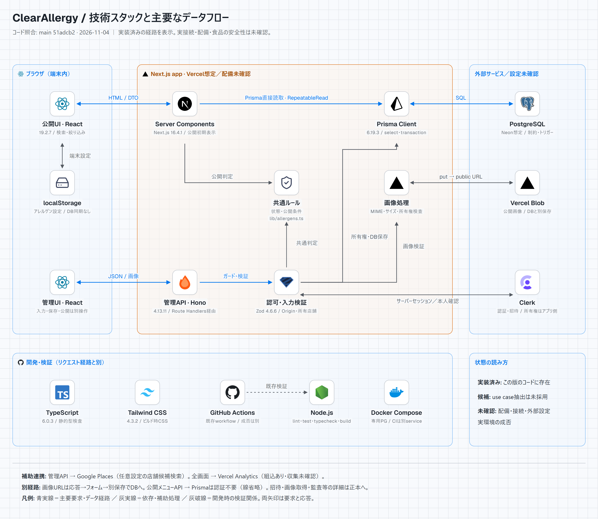

# 技術スタック俯瞰図（補助資料）

[README](../../../README.md) · [正式なシステム構成図](../architecture.md#system-diagram) · [共通ルール](../rules.md) · [今回の検証記録](../../verification/stack-diagram-20261104.md)

[HTML（テーマ切替・オフライン表示）](clearallergy-stack-overview.html) · [ライトPNG](clearallergy-stack-overview.png) · [ダークPNG](clearallergy-stack-overview-dark.png)



2026-11-04、main **`51adcb23945b80bb34b110d2d0f263d29629a821`** のソースを照合した補助資料です。仕様は既存のガイド、正式図の編集原本は `clearallergy-architecture.drawio`、表示画像は同名SVGを正本とし、両ファイルは変更していません。HTMLはこの補助図だけの編集元で、PNGは同じHTMLから出力します。

## 実装・候補・未確認

| 区分 | この資料での意味 |
| --- | --- |
| 実装済み | 対象SHAで入口から到達するコードや設定が存在する。実サービスでの成功や本番への反映を示さない |
| 候補 | 研究資料の条件付きuse case抽出等。稼働経路には接続しない。現行の機能別構成を将来レイヤーで置き換えない |
| 未確認 | 実際のVercel/Neon配備先・接続・リージョン・Clerk/Blob/Places/Analytics設定、実環境の成否。環境変数値や管理コンソールは参照していない |

候補の出典は[研究索引](../../research/README.md)から辿る[過去のtarget architecture](../../research/architecture/target-architecture.md)です。過去の[current architecture](../../research/architecture/current-architecture.md)にはキャッシュ・保存処理の古い説明もあるため、現行経路は下記の実コードと[現在の内部処理](../architecture.md)で照合しました。図の実装表示は、食品の安全性・実利用者の理解の検証結果ではありません。

## 構成・接続の根拠

矢印は主要な要求・データ経路と依存をまとめたもので、全関数の呼出順や完全なシーケンス図ではありません。青実線は主要経路、灰実線は補助処理・依存、灰破線は開発時の検証関係です。両矢印は要求と応答を表します。

| 図の要素・接続 | 実コードの根拠と読み方 |
| --- | --- |
| 公開UI ↔ Server Components → Prisma | [公開ルート](../../../app/(public)/shops/page.tsx)、[PublicShopListPage](../../../features/public/shops/server/PublicShopListPage.tsx)。初期取得は内部HTTP APIを経由せず、サーバーから直接Prismaへ。食品情報の3公開ページは `force-dynamic` |
| 公開読取のsnapshot | [readPublicSnapshot](../../../features/public/shops/server/public-read-snapshot.ts) の `RepeatableRead`。親・リンク・マスタ・補足を同一DB時点で取得。ページ表示と公開APIの経路は別 |
| 公開メニューAPI → Prisma | [公開APIの入口](../../../app/api/menus/[menuId]/route.ts) → [publicMenuRoute](../../../features/public/shops/server/publicMenuRoute.ts)。認証不要の別経路として図の脚注に記載し、線は省略。管理APIのClerk・所有店舗ガード経由とは扱わない |
| 公開UI ↔ localStorage | [設定の保存・購読](../../../lib/public-allergen-preferences.ts)。検索・選択の変更ごとにDBへ問合せず、ClerkアカウントやサーバーDBへ設定を同期しない |
| 管理UI ↔ Route Handlers → Hono | [メニューAPIラッパー](../../../app/api/admin/menus/[menuId]/route.ts) → [adminMenuRoute](../../../features/admin/menus/server/adminMenuRoute.ts)。API内でOrigin・セッション・店舗所有権・portfolio制限・Zod入力・期待版を確認 |
| 認証・所有権 → Clerk / DB | [proxy](../../../proxy.ts)、[getCurrentAppUser](../../../lib/auth/getCurrentAppUser.ts)、[getCurrentAdminContext](../../../lib/auth/admin-auth.ts)、[requireShopId](../../../lib/auth/admin-api-utils.ts)。Clerkの本人確認と、ローカルDBからの所有店舗解決は別。図のガード→Prisma線は所有権読取と業務保存を集約 |
| ページ・API → 共通ルール | [lib/allergens.ts](../../../lib/allergens.ts)。有効な4状態、公開条件、登録状態と表示用補足を区別。図は状態定義や安全文言を再定義しない |
| 管理保存 → Prisma → PostgreSQL | [DB共通入口](../../../lib/db/index.ts)、[DB定義](../../../prisma/schema.prisma)、[migration群](../../../prisma/migrations)。対象ID・所有店舗・期待版で更新し、トランザクションとDB制約で整合。内容保存と公開操作は別。実DBへのmigration適用は今回未実施 |
| 管理アップロード → Blob → URL応答 | [uploadMenuImageRoute](../../../features/admin/menus/server/uploadMenuImageRoute.ts)、[共通画像処理](../../../lib/storage/upload-images.ts)。認証・所有権・MIME・サイズ検証後に `put(access: "public")`。画像URLはフォームへ返り、後続の店舗／メニュー保存でDBへ渡る。DBとBlobは別保存で、一括rollbackを保証しない |
| 公開画像表示 | [PublicMenuDetailBodyClient](../../../features/public/shops/components/PublicMenuDetailBodyClient.tsx) のNext/Image、[画像設定](../../../next.config.ts)、[許可URL判定](../../../lib/storage/image-url-policy.ts)。図では画像取得線を省略。ブラウザからBlobへの直接アップロードは描いていない |
| 管理API → Google Places | [管理候補検索](../../../features/admin/shop/server/adminPlacesSearchRoute.ts) → [サーバーヘルパー](../../../lib/google-places.ts)。任意設定時の管理用検索。[公開の旧検索API](../../../features/public/shops/server/placesSearchRoute.ts) は外部Placesへ接続せず、公開側は登録済み店舗の検索 |
| 全画面 → Analytics | [root layout](../../../app/layout.tsx) に `Analytics` の組込あり。実際の有効化・イベント収集・保持設定は未確認 |
| 既存の開発・検証 | [package.json](../../../package.json)、[ロックファイル](../../../package-lock.json)、[CI](../../../.github/workflows/ci.yml)、[ローカル専用Compose](../../../compose.test.yaml)。CIのPostgreSQL serviceとローカルComposeを区別。図の版数はlockfileの解決版で、CIの成功を示す印ではない |

Node.js/TypeScript/Tailwindは開発・ビルドの関係を示し、本番サービス間通信の線に含めません。招待の細部、管理ページの初期読取、監査・ログ、公開ページ再検証などの詳細は正式図と[変更対応表](../change-map.md)を参照してください。公開再検証を、既に開いている画面への訂正の自動配送とは扱いません。

## Skill・ライセンスと更新

[導入記録](../../../.agents/skills/README.md)の固定commitから、既存Skillを変更せず導入しました。[Skill本文](../../../.agents/skills/stack-diagram/SKILL.md)とgeometryの手順を使い、`build.py` でフォント・ロゴを埋め込みました。外部ギャラリーへの投稿・共有操作は行っていません。

生成HTMLはスクリプトなしでライト／ダークを切り替え、画像・Geist/JetBrains Monoを埋め込んでいます。日本語はホストのYu Gothic UI等の日本語フォントを使います。日本語フォントのない端末での字形は未確認です。ロゴは再着色していません。汎用アイコンだけは上流の取得スクリプトによる色・線幅調整を含みます。

テンプレートはMIT、埋込フォントはSIL OFL 1.1です。[第三者アセットのライセンス](clearallergy-stack-overview-LICENSES.txt)、[取得URL・SHA-256](clearallergy-stack-overview-assets.json)を残し、HTML内の折畳み欄にもライセンス全文を埋め込みました。ブランド名・ロゴの権利は各所有者に属し、支持・提携を示しません。

小修正はHTMLを編集し、必ず同じHTMLから両PNGを再出力します。新規に組み立てる場合はSkillのテンプレート→座標設計→公開ロゴ取得→`build.py`→ブラウザ描画の順で進めます。図内の対象SHA・状態表示と本書の根拠も同時に更新します。

この作業ではPython版Playwrightがなく、既存のNode版Playwright 1.61.0とEdgeのChromiumエンジンでPNGを出力しました。Python版の `render_png.py` と同じくHTMLの `.canvas` を撮影します。アプリの依存・lockfileへ描画依存を追加しません。

既存Playwrightのモジュールディレクトリとブラウザが利用可能なWindows PowerShellで、リポジトリルートから実行します。パスは自分の準備済み環境に置き換えます。スクリプトはHTTP(S)通信を遮断し、両PNGを上書きします。既存の正式SVG/draw.ioには書き込みません。

```powershell
$env:PLAYWRIGHT_MODULE_PATH = 'C:\path\to\existing\node_modules\playwright'
$env:STACK_DIAGRAM_BROWSER_CHANNEL = 'msedge'
node docs/guide/diagrams/render-stack-overview.mjs
```

`PLAYWRIGHT_MODULE_PATH` は既存のNodeモジュール、`STACK_DIAGRAM_BROWSER_CHANNEL` は既存のEdgeを指定します。Chromiumが既に準備済みなら後者を省略できます。準備不足の場合は勝手にインストールせず報告します。APIの使い方はContext7経由の[Playwright公式資料](https://playwright.dev/docs/browsers#google-chrome--microsoft-edge)で確認しました。

成功時は両テーマで17ノード・20画像、欠落画像0、境界外0、文字欠け0、矢印と文字の交差0を出力し、テーマリンク・390px幅のスクロール・外部要求0・ページ例外0を確認します。その後、両PNGを実際に開いてロゴ・文字・線・境界を目視確認します。PNGは2880×2500pxです。
